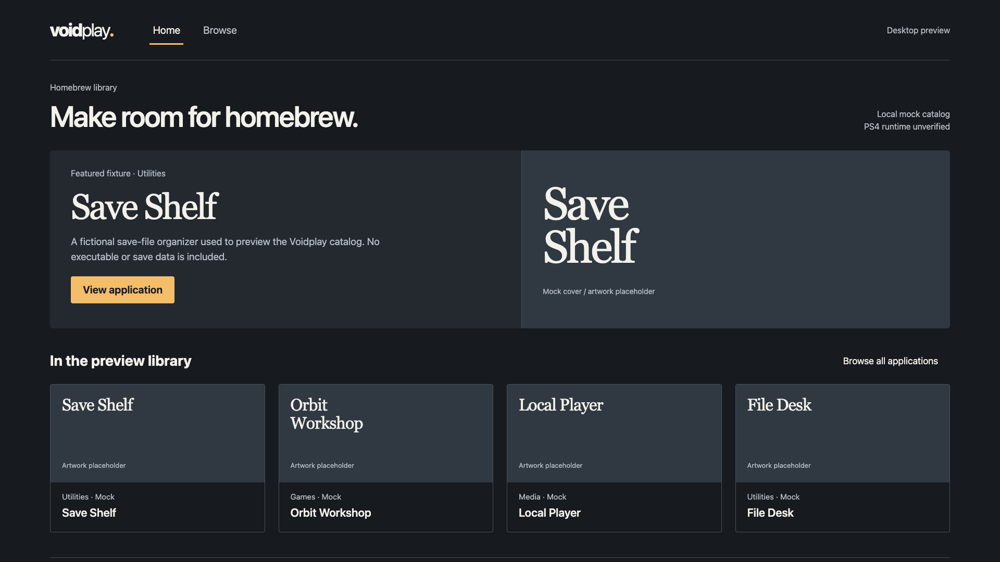

# Voidplay

An independent PS4 homebrew store project, currently a React/TypeScript desktop preview.
Only content authorized for redistribution is in scope.

The beta store has a compact cinematic Discover page, a sticky header that gains a translucent surface on scroll, a BETA
badge, focus-driven featured artwork, square and landscape shelves, a searchable Browse grid, and a dedicated
hash-addressable detail page for every entry. Search, Favorites, Library, Downloads and
Settings/About share one monochrome design system and self-hosted Manrope typography.
Header links are Discover, Browse, Downloads and Library, followed by Favorites, Search and Settings icons.



The public catalog starts in real mode with no entries. The password-protected owner studio
uses a private Mac backend to author and publish real metadata to GitHub Pages. Six fictional
concepts remain explicit test fixtures; no executable packages are published automatically.
Downloads provides an explicitly labeled dummy transfer flow. **This is not a PS4 release.** Console rendering,
controller input, network/storage behavior and installation remain unverified.
See [capability status](docs/ps4-status.md), [design](docs/design-v2.md),
[artwork provenance and prompts](docs/artwork.md) and [verification](docs/verification.md).

## Owner studio and live catalog

Run `npm run owner:serve` and open **http://127.0.0.1:5186/** on this Mac.
The requested owner password is configured privately; no plaintext password or
publishing credential is included in Git or static assets. The Pages front door
is `https://dynrbni.github.io/voidplay-ps4/admin/` and still needs this Mac backend.

Create an entry, fill metadata/genres/artwork and optional YouTube trailer,
configure 1–3 authorized sources, save/validate/preview, stage a published
snapshot, then choose **Publish to Pages**. **Check deployment** confirms the
public catalog revision; reload the application to fetch it. Drafts stay private.
See [the complete owner workflow](docs/owner-pages.md), including setup,
backups, integrity fields and the distinction between the web client and native PoC.

## Development

Requires Node >=22.18 and npm. Verified locally with Node 26.7.0.

```sh
npm ci
npm run dev
npm run check       # lint, strict types, unit tests, catalog validation, store/admin builds
npm run preview     # serve the static production build
npm run admin:dev   # separate local owner dashboard
npm run verify:public
npm run native:test # host-only native checks
```

Vite binds to loopback by default and reports its selected port. The `dist/` output is a
web preview, not a console package. No runtime credentials or external font/art service is needed.

Browser regression tests use `agent-browser` with a local Chrome installation:

```sh
npm run test:e2e
npm run test:admin # requires the separate admin production preview
```

Keep the dev server running. Set `VOIDPLAY_URL` for a different port or production preview,
`AGENT_BROWSER_BIN` if the binary is outside PATH, and `AGENT_BROWSER_EXECUTABLE_PATH`
if Chrome needs an explicit location. The four test scenarios use isolated browser sessions;
request interception and synthetic screenshot metadata exist only inside the tests.
Screenshots and audit reports are written under ignored `artifacts/`.

## Navigation and local collections

Tab and arrow keys navigate, Enter selects, and Escape goes back. Horizontal arrows stay
inside a shelf; shelf buttons and touch scrolling are also available. Browser Back and the
detail Back button restore prior focus and scrolling where that view still exists. Direct
links such as `/#/item/orbit-workshop` work on static hosting. Reduced motion respects the
system preference and the optional browser-local setting.

Favorites and tracked Library entries are separate arrays of catalog IDs in the versioned
`voidplay.collections.v1` localStorage record. No account or cross-device sync is implemented.
Clearing site data removes them. Invalid or unavailable storage produces visible feedback;
write failures retain session changes. Library tracking does not mean downloaded or installed.
Loaded catalog entries remain usable offline, but this is not an installable offline app:
there is no service worker or persistent catalog cache.

## Dummy downloads

As requested for the beta, Download to PS4 currently starts a **demo simulation** and opens
Downloads. It does not fetch a package, measure internet bandwidth, send bytes to a PS4,
write a file or install anything. The manager labels progress, sizes, speed and ETA as demo
values and supports queueing, pause/resume, cancel, retry and clearing finished demos.
One demo runs at a time and continues across store pages. Completed demos do not become
installed applications or automatically enter Library.

The bounded `voidplay.demo-transfers.v1` browser record persists demo state separately from
catalog and collections. Pending/active entries restore paused after reload; the simulator
never claims to transfer in a closed tab. Storage failures retain session state and show a
message. The dummy queue is intended for one active app tab; concurrent-tab coordination,
a live PS4 receiver and installation remain unavailable. Published entries never start a demo transfer.

## Boundaries

- `src/catalog.ts`: strict Zod catalog validation, fetch loader, filtering and sorting.
- `public/catalog.mock.json`: six fictional development listings.
- `src/App.tsx`: catalog lifecycle and page composition.
- `src/useStoreNavigation.ts`, `src/routes.ts`: hash routes, history, back and focus restoration.
- `src/navigation.ts`: directional desktop keyboard navigation.
- `src/collections.ts`, `src/useCollections.ts`: validated local collections and storage feedback.
- `src/demoTransfers.ts`, `src/useDemoTransfers.ts`, `src/Downloads.tsx`: separate dummy queue/state machine and manager.
- `src/FavoriteButton.tsx`: shared, accessible filled-heart favorite control.
- `src/FeaturedHero.tsx`, `src/ContentShelf.tsx`, `src/ContentPoster.tsx`: artwork presentation.
- `src/Details.tsx`, `src/ScreenshotGallery.tsx`: selected-item details and optional gallery.
- `src/CatalogView.tsx`, `src/CollectionView.tsx`, `src/SecondaryPages.tsx`: store screens.
- `src/main.tsx`: startup and render-error recovery.
- `public/art/`, `public/fonts/`: local concept artwork and licensed font.

The published contract lives in `shared/catalog.ts`, and `public/catalog.json` is the single
public manifest. Preview mode explicitly loads the separate fictional fixture. Each published
entry has complete metadata, authorization and one to three validated source descriptions.
Drafts, local snapshots, revision checks and imports live in the owner workspace, outside
the public build. No catalog records are duplicated in React components.

See [owner editing and safe Git publishing](docs/catalog-publishing.md) for field requirements,
backup/export/import commands, validation and the current publication contract. The admin
build is separate from `dist/`; the combined Pages build includes its public login shell.
The local owner backend protects workspace and publishing actions; no browser GitHub tokens
are used. See the owner workflow and verification report for actual Pages deployment status.

Storage, networking, real downloads and installation expose interfaces in `src/platform/`.
Settings shows an explicitly labeled desktop storage mock. Mock figures never authorize
installation. Cleanup requires compatibility, permission, verified integrity, sufficient verified
space and confirmed installation. No automatic installation or cleanup is wired up.

The independent [native diagnostic](native/diagnostic/README.md) builds a small experimental
PS4 test package; see [actual results](docs/ps4-diagnostic.md). Host/cross-build and FTP evidence
are recorded separately from on-console launch, storage, controller, HTTPS and file I/O.
Firmware 12.00 behavior remains unverified. The full React application has not been ported.

The [C++ migration foundation](framework/voidplay-native/README.md) adds a native
Mac display/input preview (`npm run native:preview`), watch mode and portable
sanitizer tests. Its separate PS4 C++ startup package isolates the reported
CE-34878-0 failure before a console renderer or full store port is attempted.
See the [source audit and staged migration](framework/voidplay-native/docs/architecture.md).
The owner admin remains a separate web tool. The C++ store rewrite is not complete;
PS4 startup/display and firmware 12.00 support need direct hardware evidence.

## Git workflow and licensing

Use stable `main` and short-lived feature branches. Check, review, commit with Conventional
Commits, push to `https://github.com/dynrbni/voidplay-ps4.git`, then open a PR. The catalog/admin milestone stacks on the corrected V2 branch while PRs #1–#3 remain unmerged.

No Overdrive/Netflix source or assets were copied. Dependency/font notices are documented in
[dependencies](docs/dependencies.md). No project-wide distribution license has been selected. Native diagnostic source has its own GPL-3.0-only license for the OpenOrbis-linked experiment.
Actual PS4 execution must be proven before choosing a console renderer or exposing installation.


## Native Voidplay [BETA]

[PS4 React](framework/ps4-react/README.md) adds a separate React 18/QuickJS-ng
runtime, View/Text/Image renderer, Mac SDL preview and PS4 VideoOut package
target. Version 01.03 ports the public hero/shelves, catalog filters, complete
detail sections, saved Favorites/Library, controller Search, Downloads and Settings.
Cross confirms, Circle returns, D-pad and the
left stick move focus. The package title/icon are Voidplay [BETA] / `voidplay.`.
Catalog r9 is bundled offline; real download/install/video and console online
refresh are not enabled. Downloads offers an explicitly labeled test simulation.
Run `npm run react:catalog:sync` after publishing to update catalog/artwork before
rebuilding. The owner reports 01.01 and 01.02 run on PS4; expanded 01.03 needs its
own console test. Install pinned dependencies inside that directory.
Root aliases: `react:doctor`, `react:test`, `react:smoke`, `react:preview`,
`react:ps4:build`, `react:ps4:verify`. Set `OO_PS4_TOOLCHAIN` to the verified
OpenOrbis release. Actual build, native preview and package checks are separate
from console installation/launch; see its verification report for hardware status.
