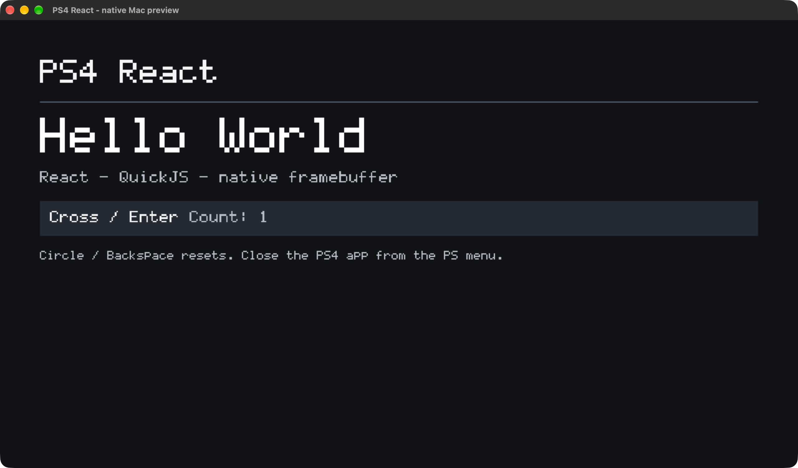
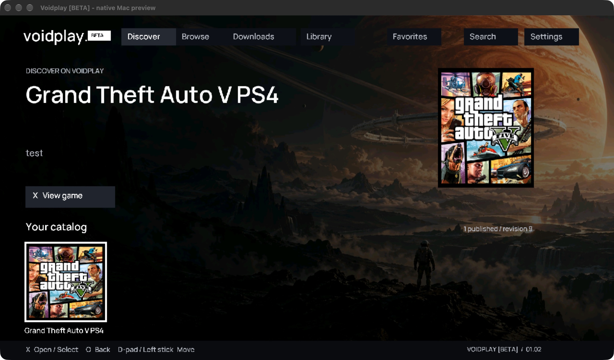
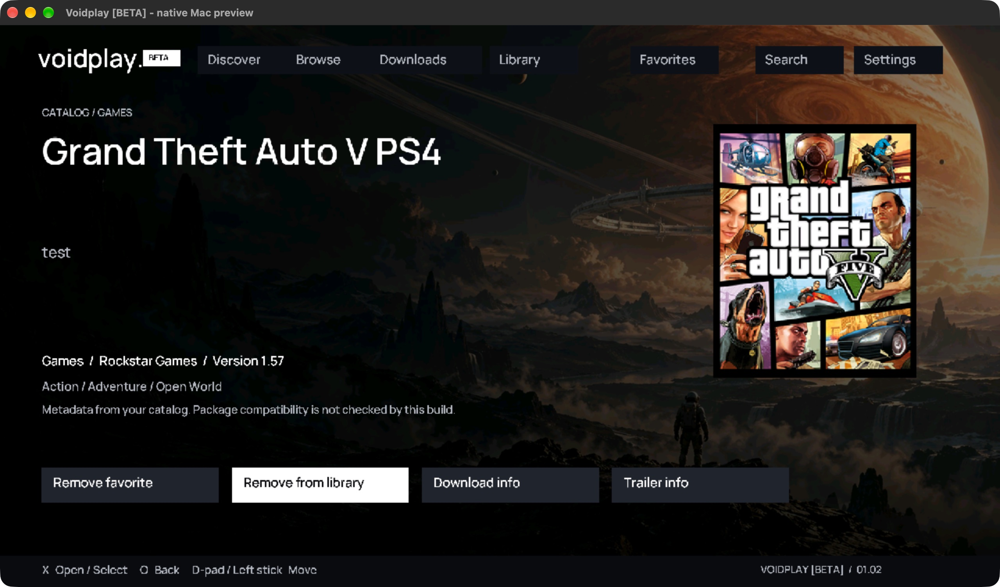
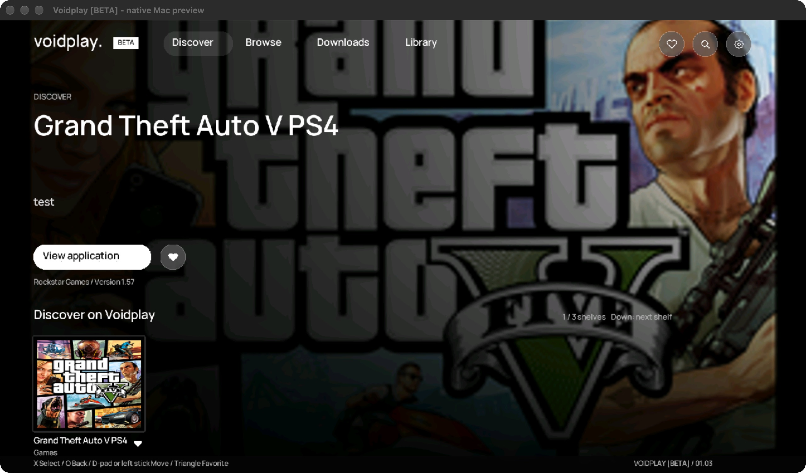
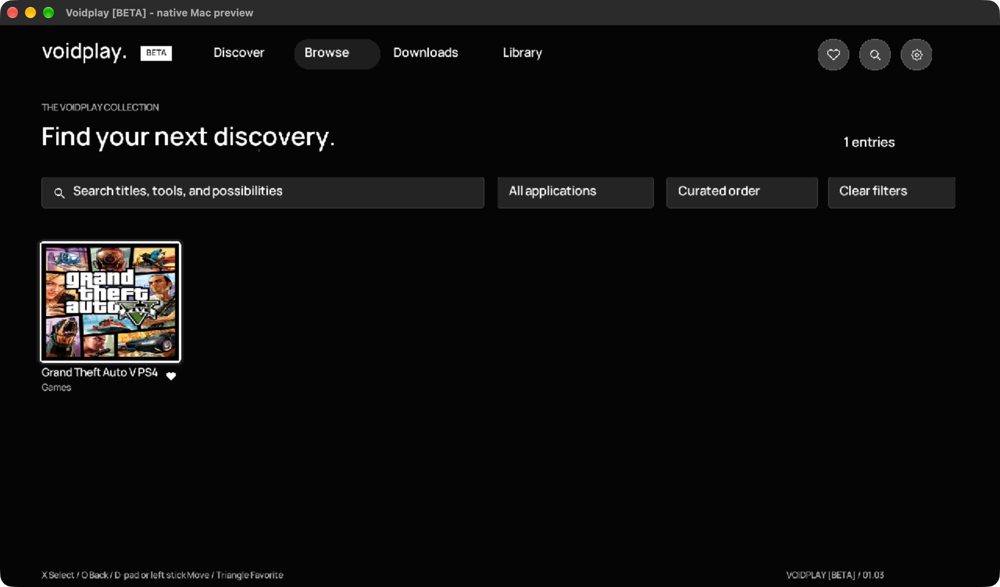
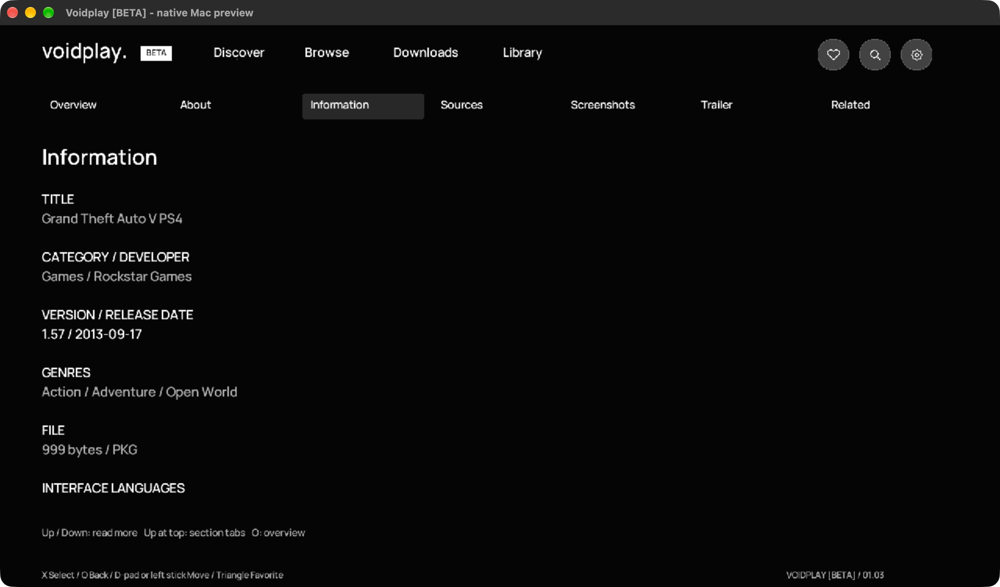

# Recorded local verification

Recorded on 2026-10-26 on the owner's macOS ARM64 development machine.
This report retains the Hello World qualification history and records the native
Voidplay 01.02 shell. Version-specific console results are kept separate.

## Implementation delivered

Real JSX is bundled with React and its reconciler, interpreted by QuickJS-ng,
and rendered through newly written View/Text host nodes, layout and a CPU pixel
renderer. The same bundle/engine/renderer runs in the native SDL Mac preview and
is linked into the OpenOrbis PS4 executable. The PS4 platform layer contains a
complete VideoOut buffer registration/flip path and Pad/UserService polling.
It is cross-built, not hardware-qualified. See [architecture](architecture.md)
for reference revisions, compatibility decisions, API and resource bounds.

Source is under `apps/`, `packages/core/`, `runtime/`, `renderer/`, `platform/`,
`tools/` and `tests/`. The root repository only adds command aliases, lint/CI
coverage and documentation. The owner backend, private catalog and live Pages
publication are preserved. Dependencies/build outputs are ignored.

## Environment and commands

| Check | Actual result |
| --- | --- |
| Node 26.7.0 / Python 3.13 / Apple Clang 21 | Available on this Mac. |
| SDL2 2.32.10 / LLVM and LLD 18.1.8 | Desktop and PS4 compilation exercised. |
| OpenOrbis v0.5.4 release | Release input hashes, actual headers/stubs and packaging tools inspected. |
| React 18.3.1 / reconciler 0.29.2 / esbuild 0.25.12 | Isolated lockfile; JSX bundle executes in the interpreter. |
| QuickJS-ng 0.15.0 | Source archive hash verified; source revision recorded in dependency lock. |
| `npm run doctor` in framework | PASS: pinned inputs, tools, npm dependencies, display/input imports and Pillow. |
| `npm test` in framework | PASS after 01.01 correction: 3 layout tests, 8 build tests, native ASan/UBSan integration executable. |
| `npm run smoke` in framework | PASS after repeated rebuild: real SDL window/texture, injected SDL key event, 8 frames, framebuffer capture and clean shutdown. |
| Root `npm run check` | PASS: lint, types, 32 existing tests, catalog validation, store and admin production builds. |
| Root `npm run verify:public` | PASS: valid public catalog; no private workspace/admin/package/credential markers. |
| Native-only PS4 graphics target | Cross-build and package structural checks passed before JS integration; physical display not tested. |
| React PS4 target | Cross-build and package/extracted-byte checks exercised. Final artifact identity is recorded by `dist/receipt.json` and its `.pkg.sha256` sibling. |
| Physical PS4 firmware 12.00 / GoldHEN | **01.00 FAIL** before `main`: missing bootstrap module files. **01.01 owner-reported successful launch**. **01.02 hardware acceptance pending**; storage/network success is not claimed. |

The sanitizer integration executes the actual bundled React app, verifies a
pixel change from state update and exact reset, repeats runtime startup/shutdown,
and tests syntax errors, execution timeout, invalid bridge arguments, clipped
rectangles and visible glyphs for every printable non-space ASCII character.
The error/stack output from those negative tests is expected; assertions pass.
Build tests reject malformed manifests, missing tools/assets and broken JSX,
and invalidate stale success receipts after build failure.

During repeated preview builds, one smoke run was killed with SIGKILL before
startup. macOS kernel logs reported a code-signature load failure. The build now
atomically replaces the executable inode and ad-hoc signs/verifies the app bundle
after replacement. Subsequent repeated smoke runs passed. This Mac issue is not
evidence identifying the earlier PS4 CE-34878-0 cause.

## Visible desktop evidence

The native OS window was inspected directly: Enter changed Count 0 to 1,
Backspace restored 0 and Escape exited with `[shutdown] clean`. This is a native
Mac preview screenshot, not a PS4 capture or browser mockup:



Design is intentionally a static qualification screen: dark neutral background
keeps scanout/text defects visible, white bitmap text avoids a font/GL dependency,
large headings remain readable from a TV and one counter strip exposes React
updates. ENERGY 1 / RHYTHM 1 / MOTION 1. No decorative assets or simulated store
features are used as evidence of native compatibility.

## Artifacts and acceptance

From `framework/ps4-react/`, `npm run build:ps4` produces:

- `build/ps4/app.elf`, `app.oelf`, `eboot.bin`, SFO/icon/GP4 and packaged SFO.
- `dist/Voidplay-BETA.pkg`, `.pkg.sha256` and `dist/receipt.json`.
- `build/commands.log` with exact commands/outputs for diagnosis.

The receipt records input/output hashes, source commit, whether framework source
was dirty, title/version, package hash/size and `console_launch: unverified`.
The local verifier checks ELF/SELF structure, SFO fields, package digests, header
and debug signatures, then extracts and compares executable, icon and notices.
Only the packager-generated 96-byte keystone and publication SFO fields are allowed
as additions. No proprietary Sony runtime PRX/SPRX is included. A local signature
check does not establish installation or compatibility with Sony's retail policy.

Re-run `npm run verify:ps4` before transferring. Follow the exact
[FTP/manual installation and log capture procedure](../README.md#transfer-install-and-test).
FTP moves bytes; only the user's installer registers the app. Previous full-size
FTP writes failed read-back, so no such copy is accepted as verified. The owner
previously could not install the replacement Boot Test; it is a different artifact.
The subsequent 01.00 console result is recorded below; the corrected 01.01 build
requires its own launch test.

The owner subsequently enabled FTP/Klog for this package. Both endpoints were
reachable and the read-only Klog capture received 38,629 bytes, with no PS4 React
startup marker. FTP accepted all 6,619,136 bytes under a unique `.uploading` name.
Full read-back failed with 426/timeouts in passive, active, advertised REST resume
and an enlarged client receive-buffer attempt. A resumed prefix matched the local
source byte-for-byte, but a full destination SHA-256 was not obtained. The remote
copy remains `ready=false`, was not renamed to `.pkg` and was not installed or
launched by the agent. Raw logs/transfer receipts stay in the ignored local build
directory. The verified Downloads artifact can instead be copied using a USB
device already supported by the owner's installer, or a successful manual transfer.

## Confirmed 01.00 loader failure and 01.01 candidate

After the owner installed 01.00 manually, Klog for `RCTX00001`, application version
`01.00`, captured two launch failures before any `[ps4-react][startup]` marker:

```text
# exception: 0xa0020102 (PRX_SCE_MODULE_LOAD_ERROR)
# === Lack of a .prx file in /app0/sce_module is detected!!! ===
```

The package had no application bootstrap PRX files. Static musl linkage does not
satisfy the console's separate module preload requirement. This is a packaging
defect in 01.00; its passing Mac and integrity checks did not detect this runtime
requirement. A generic “cannot continue” message or immediate exit can accompany
the loader killing the process. No React, rendering or controller execution was
established by these failed launches.

Version 01.01 compiles the small GPL OpenOrbis libc and FIOS bootstrap shims, links
the pinned GPL `crtlib.o` plus public import stubs and converts them to dynamic
PRX modules. It includes both files under `sce_module/`. No proprietary Sony
module or prebuilt sample PRX is copied. The package validator now rejects the
old module-free file list, invalid SELF files and an executable substituted for
a dynamic module. Hash checks cover the extra toolchain inputs; receipts and
extracted-byte comparison cover the generated modules.

Fresh local checks pass: 8 build/error tests (including 3 bootstrap regressions),
3 layout tests, real React integration under ASan/UBSan, SDL smoke, root 32 tests,
lint/types, store/admin builds and public-output validation. Both generated PRXs
have the SDK module type `0xfe18` and the expected import libraries. Package
conversion/validation/extraction passed. This fixes the locally verified omission;
it does not establish successful PS4 startup for 01.01. The exact final package
hash/source commit remain in its generated receipt and checksum file.

The next smallest milestone is to install the exact HelloWorld hash on the actual
console, capture startup logs, verify both headings for at least 30 seconds,
test Cross/Circle and close from the PS menu. If startup fails, preserve the
faulting logs and screen before adding any component, catalog or network feature.


## Voidplay native 01.02

The owner reports 01.01 now runs smoothly on firmware 12.00/GoldHEN. This is a
user-reported outcome, not an independently captured timing/input trace. Preserve
its bootstrap fix; do not infer that every new screen or native service is proven.

The 01.02 package is titled `Voidplay [BETA]`, retains `RCTX00001` for updating
that application, and uses the existing white `voidplay.` wordmark as its icon.
The default React app renders a bundled public r9 catalog, artwork and Manrope.
No private drafts, game executable, owner secret or download operation is included.

Local validation covers 4 layout tests, 4 store navigation/state tests, 8 Python
build/guard tests, native ASan/UBSan runtime/input/image bounds tests and a real
SDL smoke run. Root checks also passed: lint, types, 32 tests, catalog validation,
store/admin builds and public artifact checks. The PS4 executable and bootstrap
modules cross-build; package verification compares extracted bytes, SFO and icon.
The generated receipt/checksum records the exact final source and package identity.

Actual native Mac interaction verified Enter opens details, Backspace restores
its route, favorite/library actions populate their pages, search types a query
and opens its result, and Settings opens catalog information. Screenshots below
are **native Mac preview captures**, not PS4 captures:




The catalog is offline and needs a rebuild to update. Session collections are
not persisted, downloads/install/network/storage/video are unavailable, and the
renderer is a fixed 1080p ASCII subset. The next console acceptance is to install
the exact 01.02 artifact, observe Discover for 30 seconds, navigate each route
with D-pad/left stick, confirm with Cross and return with Circle. No agent-side
01.02 installation or console test has been performed.

## Native web experience 01.03

The owner subsequently confirms native 01.02 runs well on the actual PS4. This
owner-reported result qualifies that previous artifact, not the expanded 01.03.

The public web store's compact header, hero/category shelves, query/category/sort
filters, separate saved collections, full detail tabs/metadata/source fields,
screenshot/trailer states, related listings, Downloads and Settings now have
native implementations. Preferences and reduced motion have a bounded owned-file
bridge. There is an explicit opt-in transfer simulation; it does not perform real
network/file/package operations. Gallery images must be included by catalog sync;
this current r9 entry has no screenshots or trailer, so those empty states are
what can be exercised with the owner's actual catalog.

Local verification includes 5 layout tests, 7 store/persistence/queue state tests,
8 Python build guards, native ASan/UBSan direction/image/rounded-alpha bounds,
atomic preferences read/write and React lifecycle/error/timeout checks, plus SDL
smoke. Root lint/types/32 tests/catalog/store/admin builds and public checks pass.
The first integration rejected negative focus-ring coordinates; signed offsets
are now bounded separately from positive dimensions. The first PS4 compilation
found fileno hidden by the SDK's POSIX declaration guard; the source enables the
actual declared interface. A subsequent cross-build and package extraction pass.

Actual Mac UI inspection verifies full detail metadata/sources, query keyboard,
Settings reduce motion, saved favorites/library JSON and paused simulation queue.
A clean-source final artifact and exact checksum are recorded in the generated
receipt and handoff. New PS4 display/input/performance/preferences behavior is
**unverified** until the owner installs and tests the exact 01.03 package.

Remaining service gaps: native catalog HTTP refresh, native YouTube playback,
real downloads/install/cleanup, measured console capacity and Unicode shaping.
The public view port is not a claim of those integrations or exact DOM/CSS parity.

The latest native Mac preview was restarted after saving preferences: the filled
favorite and Reduce motion preference survived. These final captures are native
Mac windows, not PS4 screenshots or browser mockups:





UI delivery audit: focus/navigation PASS (state tests and actual keyboard input);
content/empty states PASS (published r9 plus filtered empty catalog); visual
identity PASS (web Manrope/wordmark/neutrals and native captures); interaction
PASS for the implemented controls (filters, keyboard, collections, metadata and
simulation); capability labels PASS (no mock speed/storage represented as real).
