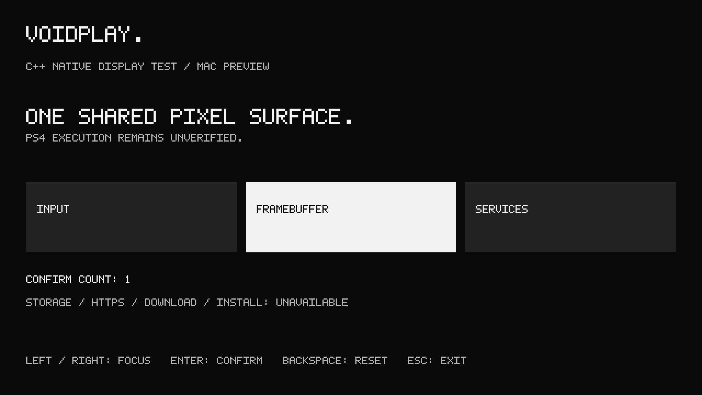

# Voidplay native C++ foundation

This directory starts the C++ client migration. It currently provides a **native
Mac display/input test** and a **separate minimal PS4 startup experiment**.
It does not contain the complete store UI. No replacement artifact has been
validated on PS4 firmware 12.00. Read [architecture and migration gates](docs/architecture.md).

## Environment

Mac preview: macOS, Command Line Tools/Apple Clang, Python 3 and SDL2.
No browser, Node runtime or CMake is needed by the native code.

```sh
xcode-select --install # only if Command Line Tools are missing
brew install sdl2 llvm@18
```

PS4: complete [OpenOrbis v0.5.4 LLVM-18 release](https://github.com/OpenOrbis/OpenOrbis-PS4-Toolchain/releases/tag/v0.5.4).
Verify the archive against `dependencies.lock.json` before extracting it.
Set the release sysroot and the versioned compiler path explicitly:

```sh
export OO_PS4_TOOLCHAIN=/absolute/path/to/OpenOrbis/PS4Toolchain
export LLVM18_BIN=/opt/homebrew/opt/llvm@18/bin
python3 -B framework/voidplay-native/tools/cli.py doctor
```

Doctor checks eight pinned release inputs, compiler/linker major version and
tools, plus the Mac compiler/SDL version. It never installs dependencies,
connects to the console or certifies firmware support. A source checkout with
empty `lib/` is insufficient. Existing default LLVM/shell settings need no changes.
Use Apple Clang for Mac sanitizer tests: the installed LLVM-18 ASan runtime
spun during initialization on this Mac's macOS 27; Apple Clang tests passed.

## Native Mac preview

Run from the repository root:

```sh
npm run native:preview
npm run native:watch
npm run native:runtime:test
npm run native:mac:smoke
```

Equivalent commands without npm:

```sh
python3 -B framework/voidplay-native/tools/cli.py mac-build
python3 -B framework/voidplay-native/tools/cli.py mac-run -- --width 1920 --height 1080
python3 -B framework/voidplay-native/tools/cli.py mac-watch
sh framework/voidplay-native/tools/test-portable.sh
python3 -B framework/voidplay-native/tools/cli.py mac-smoke
```

The default software surface is 1920×1080 in a resizable 1280×720 native window.
`--width`/`--height` configure the surface; `--frames N` exits after a bounded run;
`--capture path.bmp` saves the software frame. The CLI uses this framework
directory as the preview's working directory. Left/Right move focus, Enter
confirms, Backspace resets and Escape closes. SDL controller D-pad, A/Cross,
B/Circle and Start map to focus/confirm/back/exit. The smoke test injects
keyboard/controller events; no physical controller has been tested.
Watch rebuilds/restarts on C++/header/tool changes, reports build errors and
waits for the next edit. Restart the watcher after editing the Python watcher
itself; it is not hot reloaded. State resets on every restart. Ctrl+C stops it.

The preview reports raster time for this Mac, not PS4 performance. Services
including storage, HTTP, downloads and installation are unavailable. It is not
a PS4 emulator. The diagnostic bitmap font is temporary test typography.



## PS4 startup build and verification

```sh
npm run native:ps4:build
npm run native:ps4:verify
```

Or use `python3 -B framework/voidplay-native/tools/cli.py ps4-build` and
`ps4-verify`. The build uses LLVM/LLD 18, OpenOrbis CRT/linker script, 16 KiB
load alignment, FSELF conversion and PS4 GP4/PKG tooling. It produces:

```text
framework/voidplay-native/build/ps4-boot/
  IV0000-VPLY00002_00-VOIDPLAYBOOT0001.pkg
  receipt.json / package.sha256 / build.log
  boot.elf / boot.oelf / eboot.bin / boot.d
  packaged-param.sfo
```

`VPLY00002`, version `01.01`, title **Voidplay C++ Boot Test** is separate from
the previous diagnostic. Check that this title ID is unused on the console.
The package intentionally shows no UI: it logs entry and remains alive with one-second
heartbeats. Close it from the PS button menu. A blank screen is expected;
returning through the bundled libc exit path is no longer part of this probe.
It tests startup, not graphics, controller, storage, networking or the store.

Each build attempt invalidates its previous receipt first. Receipts hash source,
tools, compiler, SDK link inputs, compiler-discovered headers and output bytes.
Verification rejects stale inputs/outputs, validates ELF/SELF bounds, runs the
SDK PKG hash/signature validator, extracts and compares executable/modules/icon,
and checks SFO application fields. PkgTool adds `PUBTOOLINFO`/`PUBTOOLVER`;
the final SFO is saved and hashed. These are local structural checks, not console
execution or a cryptographic signature by the project owner. Receipts contain
local paths; keep build output private. Builds are not promised bit-identical
across host versions (the packager adds timestamps).

## Explicit transport and log capture

Enable the console's FTP and GoldHEN Klog servers first. GoldHEN documents
[Klog on port 3232](https://github.com/GoldHEN/GoldHEN#features); availability and
debug output routing on the owner's actual build still need verification.

```sh
python3 -B framework/voidplay-native/tools/console.py transfer --host PS4_IP --port 2121
python3 -B framework/voidplay-native/tools/console.py collect-klog --host PS4_IP --port 3232 --seconds 30
```

Transfer verifies the local build, refuses an existing destination, uploads a
unique file without a `.pkg` suffix, checks size and full read-back SHA-256,
then renames it to `/data/Voidplay-Cpp-Boot-01.01-<hash>.pkg`. A timeout leaves
the partial file and a failed `transfer.json`; it never marks an unverified
copy ready, installs, launches or deletes anything. FTP credentials, when
needed, come from local `VOIDPLAY_FTP_USER`/`VOIDPLAY_FTP_PASSWORD` environment
variables. Do not put them in source, browser bundles or public catalog JSON.

Use the owner's Internal Package Installer/file manager manually on the exact
verified file. A standalone installer scanning `/data` differs from GoldHEN's
`/data/pkg` mode; choose the path appropriate to the installed tool. This
transport deliberately stages under `/data` and does not invoke an installer.
Start bounded Klog capture before opening the title. Logs are stored exclusively
in ignored `build/evidence/`; an existing capture is never overwritten. Review
private logs before sharing. An empty stream does not establish startup success.

## Acceptance evidence

[Actual results and console test procedure](docs/hardware-evidence.md) distinguish
Mac tests, cross-compilation, artifact validation, transfer and hardware launch.
Only a new recorded console run can unblock the display stage. The old web
store/admin and diagnostic remain separate. License/provenance: [NOTICE](NOTICE).
